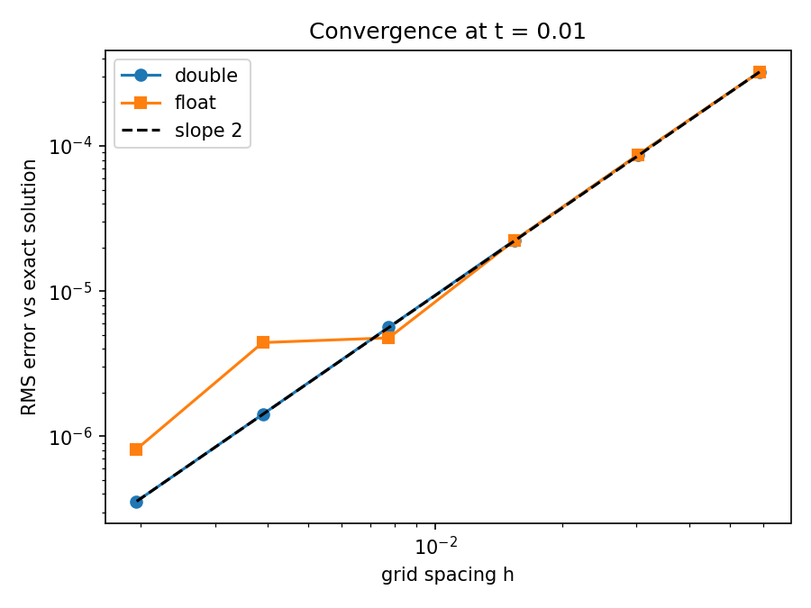
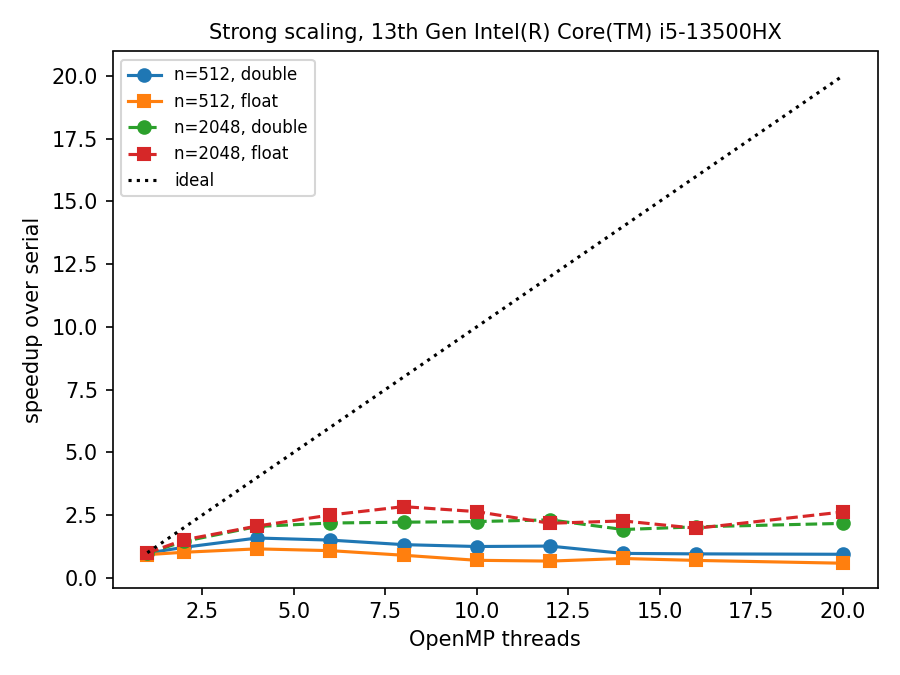
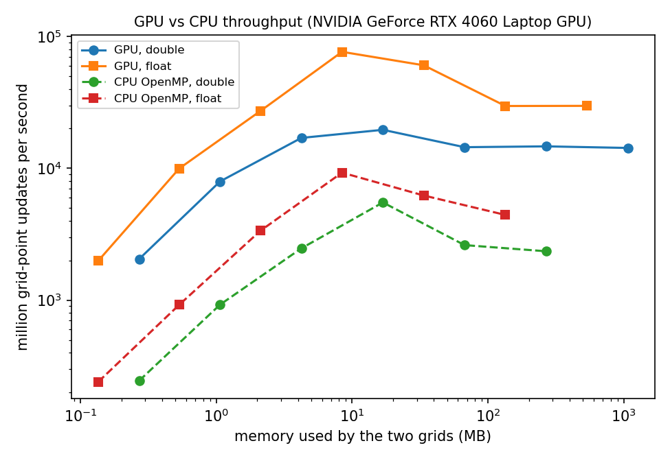

# heat-solver

A small study of how a simple scientific code behaves on real hardware: the 2D heat equation
solved serially, with OpenMP on the CPU and with CUDA on the GPU, in single and double precision,
together with a benchmarking tool that runs every experiment and produces the plots below.

## The problem

$$u_t = \alpha\,(u_{xx} + u_{yy}) \quad \text{on } [0,1]^2, \qquad u = 0 \text{ on the boundary}$$

With the initial condition $u = \sin(\pi x)\sin(\pi y)$ the exact solution is
$u = e^{-2\pi^2 \alpha t}\sin(\pi x)\sin(\pi y)$, so every run is checked against the analytical answer.

The solver uses the explicit FTCS scheme: each new grid value is the old value plus
$r = \alpha\,\Delta t / h^2$ times the 5-point discrete Laplacian. It is stable for $r \le 1/4$.

## Layout

| Path | What it is |
|---|---|
| `src/main.cpp` | Solver driver with the serial and OpenMP back ends; prints one JSON line per run |
| `src/heat_cuda.cu` | CUDA back end: one GPU thread per grid point |
| `bench/heatbench.py` | Benchmarking tool: sweeps configurations, repeats runs, writes CSVs, plots and `results/report.md` |
| `scripts/` | Build and run helpers for Linux / WSL |
| `results/`, `figures/` | Data and plots from the runs described below |

## Build and run

CPU only (any C++17 compiler with OpenMP, e.g. GCC on Windows or Linux):

```bash
cmake -S . -B build -DCMAKE_BUILD_TYPE=Release
cmake --build build
./build/heat --n 1024 --steps 200 --backend omp --precision float
python bench/heatbench.py cpu          # convergence, OpenMP scaling, CPU throughput
```

With the GPU back end (Linux or WSL with the CUDA toolkit; CMake picks it up automatically):

```bash
bash scripts/build_linux.sh            # builds build-linux/heat
python3 bench/heatbench.py gpu --build build-linux
# On a machine whose GPU cannot be auto-detected, pass the architecture, e.g. -DHEAT_CUDA_ARCH=75
```

`heatbench.py` keeps each experiment's results in its own CSV, so CPU and GPU experiments can be run
on different systems and still end up in one report (`python bench/heatbench.py report`).

## Results

Hardware: laptop with an Intel Core i5-13500HX (6 performance + 8 efficiency cores, 20 threads)
and an NVIDIA GeForce RTX 4060 Laptop GPU (8 GB). CPU experiments ran on Windows, GPU experiments
under WSL on the same machine. Timings on a laptop vary from run to run by roughly 10 to 20 percent;
the patterns below were stable across runs.

### 1. Accuracy: second order, until single precision runs out of digits



Double precision converges at the expected second order all the way down. Single precision follows
it until the discretisation error falls to about $10^{-5}$; beyond that, rounding error accumulated
over thousands of time steps dominates and refining the grid stops helping.
The GPU gives exactly the same errors as the CPU in both precisions, which checks the CUDA code.

### 2. CPU: 20 threads give only 2 to 3 times the serial speed



On a large grid the OpenMP version reaches about 2 to 3 times the serial speed; on a small grid extra
threads make it slower. Likely causes, to be tested one at a time:

1. *Memory bandwidth.* Each update does only a handful of arithmetic operations per value
   loaded, so on large grids the cores wait for memory.
2. *Hybrid cores.* The static schedule gives every thread the same number of rows, but the
   efficiency cores are slower, so the performance cores finish first and wait.
3. *Per-step overhead.* On small grids a time step takes microseconds, comparable to the cost of
   starting and synchronising the threads.

### 3. GPU: the speedup is the bandwidth ratio, and double precision is not 64 times slower



- **Large grids** (bigger than the GPU's 32 MB L2 cache): the GPU sustains about 230 GB/s in both
  precisions, close to the card's memory bandwidth, and is roughly 6 to 7 times faster than the
  CPU, about the ratio of GPU to CPU memory bandwidth.
- **Double vs single precision.** This consumer GPU does double-precision arithmetic at 1/64 of
  the single-precision rate, yet double is only about **2 times** slower here: exactly the ratio of
  bytes moved. The stencil does so little arithmetic per byte that the arithmetic units are never
  the bottleneck; memory is.
- **Mid-sized grids** that fit in L2 run faster than memory bandwidth allows (up to about 600 GB/s
  of effective traffic for single precision), because the data never leaves the cache.
- **Small grids** are limited by the fixed cost of launching a kernel for every time step.

## Next steps

- Test the three CPU explanations one by one (dynamic scheduling, pinning threads to the
  performance cores, one parallel region for all time steps).
- Reduce kernel-launch overhead for small grids (several time steps per launch).
