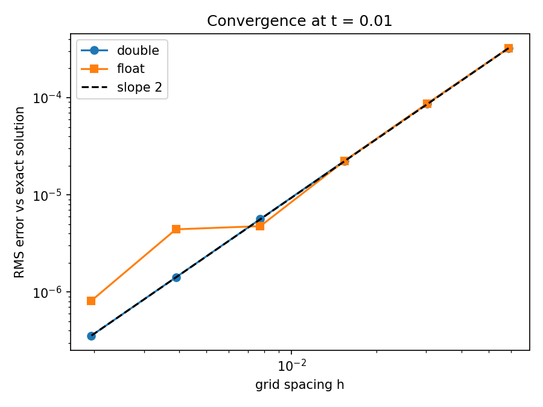
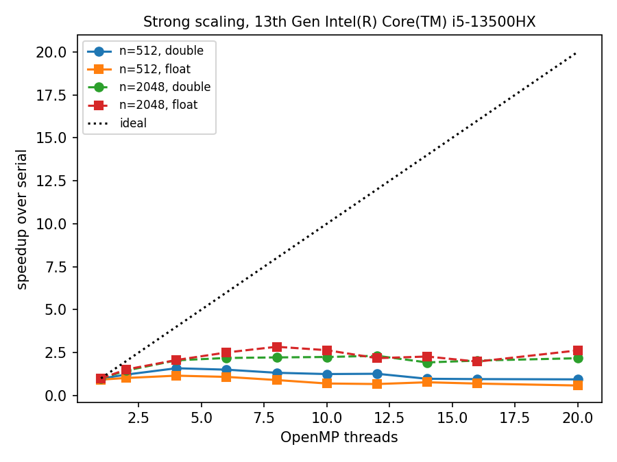
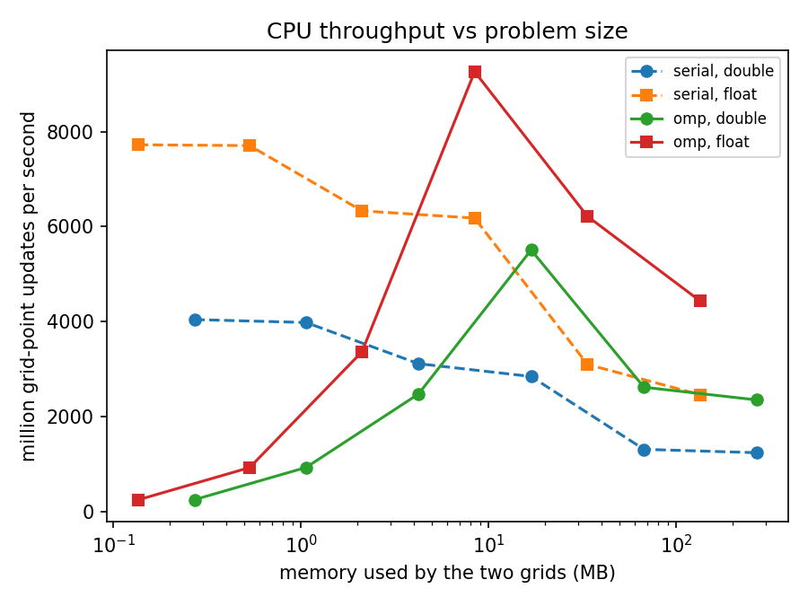
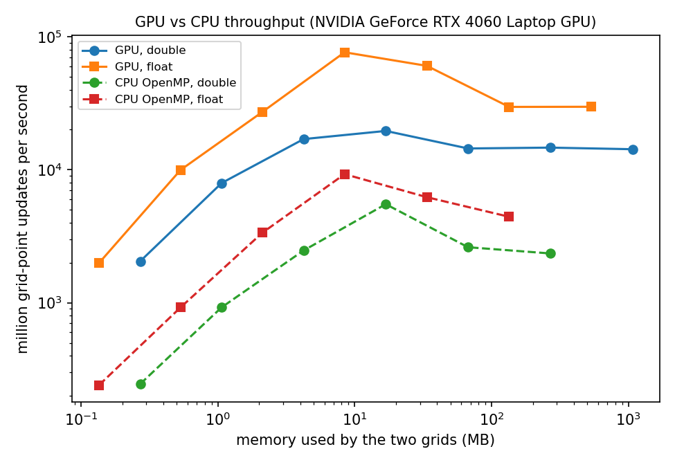

# heatbench report

CPU: 13th Gen Intel(R) Core(TM) i5-13500HX

## Accuracy

| precision | observed order (coarse grids) | smallest RMS error |
|---|---|---|
| double | 1.99 | 3.55e-07 |
| float | 2.00 | 8.12e-07 |

## OpenMP scaling

| n | precision | best speedup | at threads | speedup at max threads |
|---|---|---|---|---|
| 512 | double | 1.59 | 4 | 0.94 |
| 512 | float | 1.16 | 4 | 0.58 |
| 2048 | double | 2.31 | 12 | 2.17 |
| 2048 | float | 2.84 | 8 | 2.63 |

## CPU throughput vs problem size

## GPU (NVIDIA GeForce RTX 4060 Laptop GPU)

GPU and CPU errors agree to a relative difference of 0.0e+00.

| n | grid MB (double) | double MLUPS | float MLUPS | float / double |
|---|---|---|---|---|
| 128 | 0.3 | 2052 | 1990 | 0.97 |
| 256 | 1.1 | 7946 | 9951 | 1.25 |
| 512 | 4.2 | 16992 | 27201 | 1.60 |
| 1024 | 16.8 | 19570 | 76337 | 3.90 |
| 2048 | 67.2 | 14448 | 60364 | 4.18 |
| 4096 | 268.7 | 14659 | 29657 | 2.02 |
| 8192 | 1074.3 | 14259 | 29728 | 2.08 |

